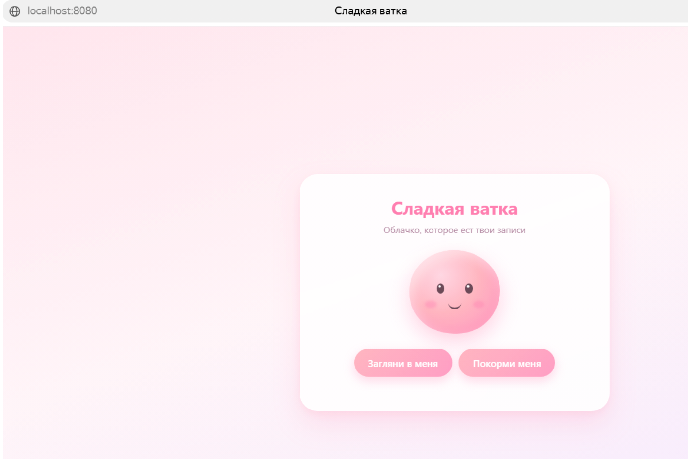
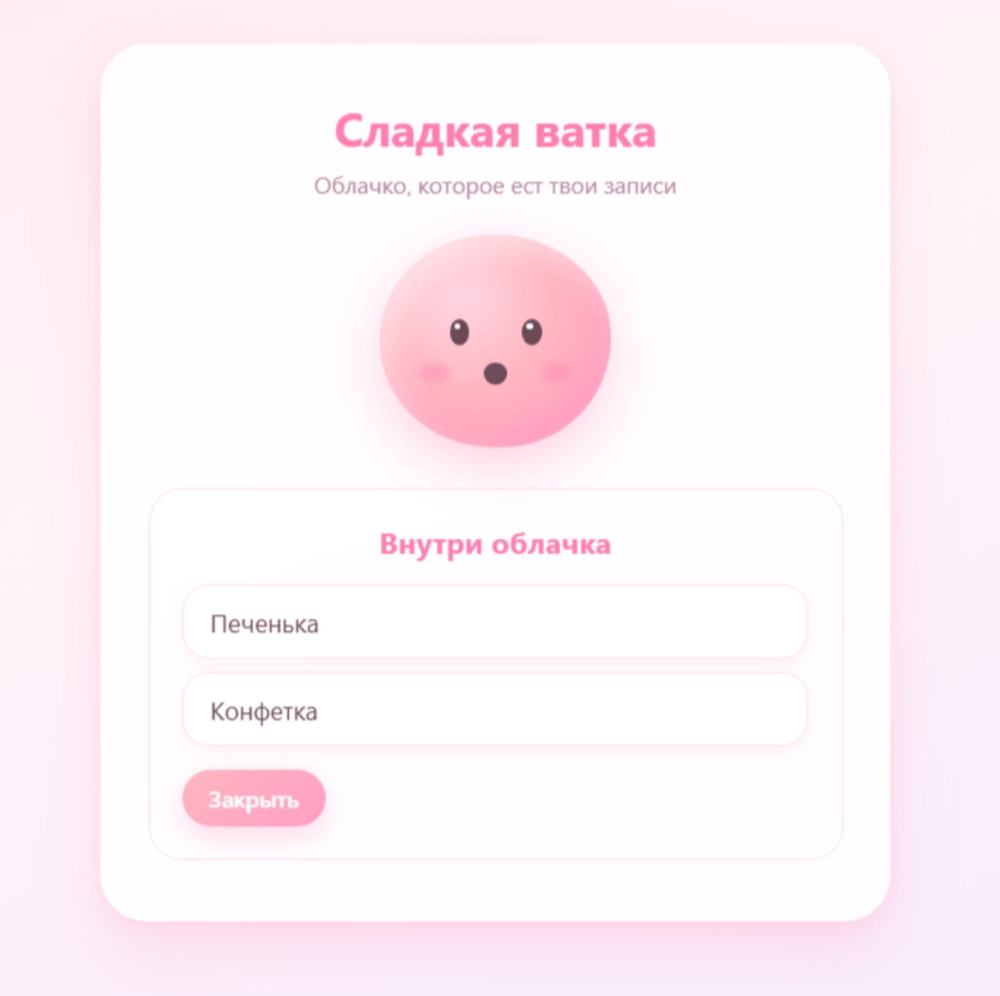
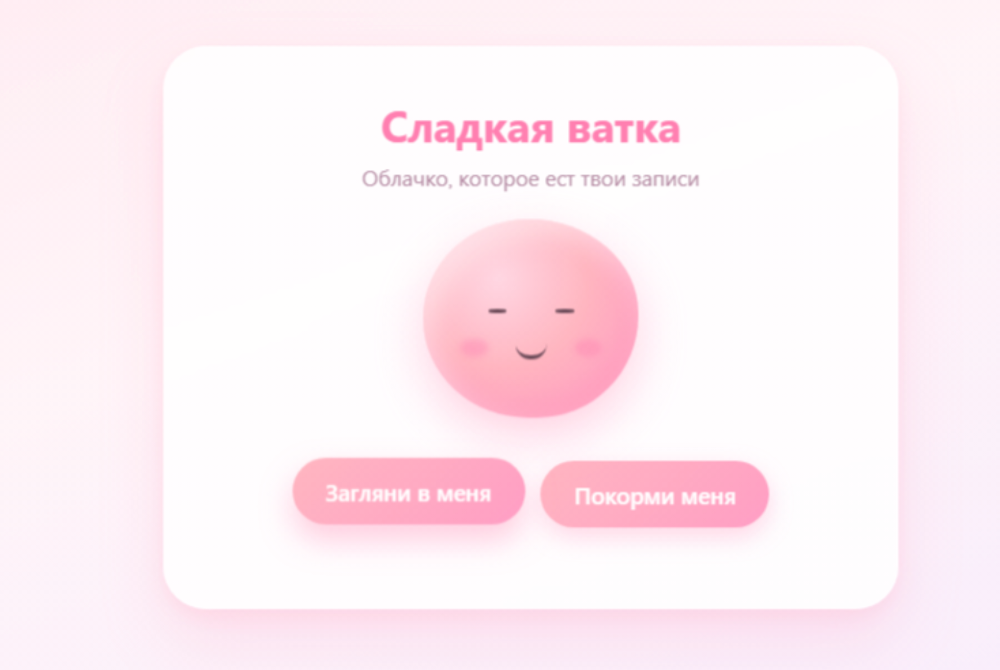

Министерство науки и высшего образования Российской Федерации

**ФЕДЕРАЛЬНОЕ ГОСУДАРСТВЕННОЕ АВТОНОМНОЕ  
ОБРАЗОВАТЕЛЬНОЕ УЧРЕЖДЕНИЕ ВЫСШЕГО ОБРАЗОВАНИЯ**

**НАЦИОНАЛЬНЫЙ ИССЛЕДОВАТЕЛЬСКИЙ УНИВЕРСИТЕТ ИТМО**

ITMO University

**ФАКУЛЬТЕТ ПРИКЛАДНОЙ ИНФОРМАТИКИ**

   

**Отчет по лабораторной работе № 0**  
по дисциплине «Введение в облачные технологии»

**Тема: «Свой сервис»**

   

Выполнили:

Чеченко К. С.  
Клабукова Л. М.  
Журавлева-Емельяненко А. В.

    

Санкт-Петербург  
2026 г.

---

# 1. Разработка фронтенда сервиса «Сладкая ватка»

Интерфейс представляет собой фон с персонажем — «кружочком» сладкой ваты.  
По идее, это должно было быть пушистое облако, но как-то сложно.

## 1. Цель работы

Разработать frontend для веб-сервиса «Сладкая ватка». Задача включала создание интерактивного пользовательского интерфейса, который умеет отправлять данные на сервер (бэкенд) и отображать их, получая ответ в формате JSON.

## 2. Стек технологий

- HTML: Создание каркаса страницы (разметка кнопок, форм и текста).
- CSS: Красивое оформление интерфейса (цвета, тени, плавные анимации и ровное расположение элементов).
- JavaScript: «Оживление» страницы (реакция на клики, отправка данных на сервер и вывод списка записей).

## 3. Реализация компонентов

### А. Верстка и структура (index.html)

Вся структура разделена на блоки: шапка с текстом, визуализация персонажа (вложенные `div` для глаз, щечек, рта), панель с кнопками и форма для ввода новой записи.

Формы и элементы управления скрываются и показываются с помощью атрибута `hidden`.

### Б. Стилизация и анимации (style.css)

Особое внимание уделялось визуальной привлекательности:

**Дизайн:** Использован пастельный градиентный фон, скругления и мягкие тени.

**Анимации персонажа:**
- Реализована плавная анимация парения облачка по вертикали с помощью `@keyframes`.
- Добавлены интерактивные состояния: при клике на кнопку персонаж «моргает» (глаза сжимаются) и «жует» (рот превращается в кружок). Это реализовано через добавление CSS-классов `.blinking` и `.eating`.

### С. Логика и взаимодействие с API (app.js)

Вся динамика приложения написана на JavaScript:

Настроены функции `getItems()` (GET-запрос на получение списка) и `postItem(title)` (POST-запрос на сохранение записи).

Написаны функции для отрисовки списка записей (`renderItems`), а также для показа/скрытия ошибок: если сервер недоступен, пользователь видит сообщение об ошибке, а не падение страницы.

**Обработка событий:**
- При отправке формы (кнопка «Скормить») происходит событие `submit`, текст перехватывается, очищается от пробелов и отправляется на сервер.
- После успешной отправки список записей автоматически перезапрашивается, чтобы пользователь сразу увидел новую запись.

## 4. Вывод

Был разработан функциональный и визуально привлекательный фронтенд для сервиса - по мне, так вышло миленько, хоть и не получилось совсем к формату ваты приблизить.

---

# 2. Разработка бэкенда сервиса «Сладкая ватка»

## 1. Цель работы

Разработать серверную часть веб-сервиса «Сладкая ватка», обеспечивающую взаимодействие с frontend и обработку пользовательских записей. Бэкенд должен принимать запросы от клиента, возвращать данные в формате JSON и предоставлять возможность добавления новых записей.

## 2. Стек технологий

- **Python** — язык программирования серверной части.
- **Flask** — фреймворк для создания веб-сервера и API.
- **Flask-CORS** — библиотека для разрешения запросов от frontend, размещённого отдельно от backend.

## 3. Реализация API

Для взаимодействия с frontend были реализованы два эндпоинта:

- `GET /api/items` — возвращает список записей в формате JSON.
- `POST /api/items` — принимает новую запись, проверяет наличие текста и добавляет её в хранилище. При успешном создании возвращает запись с присвоенным идентификатором.

Для хранения записей на этапе разработки использовался временный список Python. Это позволило проверить работу API до подключения отдельной базы данных.

## 4. Взаимодействие с frontend

Frontend отправляет HTTP-запросы к серверу с помощью JavaScript. При загрузке страницы выполняется GET-запрос для получения списка записей. При отправке формы введённый текст передаётся на сервер POST-запросом, после чего список обновляется.

Для проверки работы backend был запущен локальный Flask-сервер. Корректность GET-эндпоинта проверялась через браузер по адресу `http://localhost:5000/api/items`, где сервер возвращал список записей в формате JSON.

## 5. Вывод

В ходе работы была разработана серверная часть сервиса «Сладкая ватка» на Flask. Реализованы эндпоинты для получения и добавления записей, а также обеспечено взаимодействие backend с frontend через HTTP-запросы. Временное хранилище позволяет проверить работу API; дальнейшая интеграция с отдельной базой данных предусмотрена в рамках общей разработки проекта.
